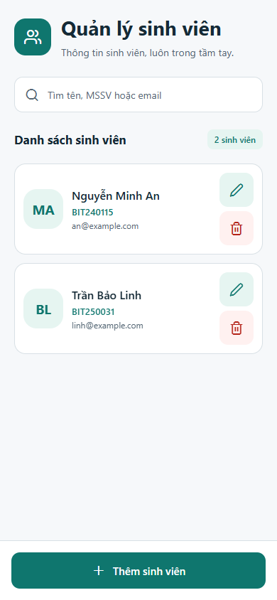
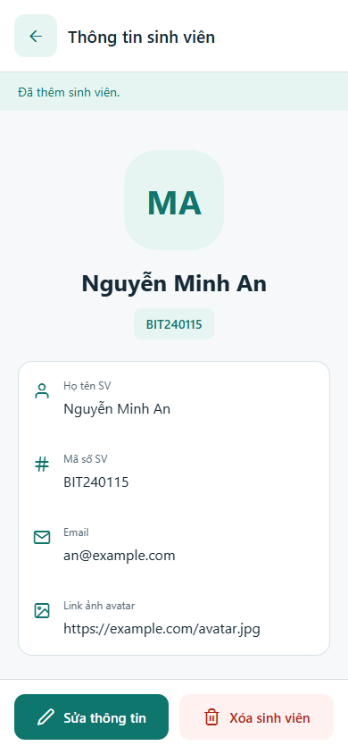
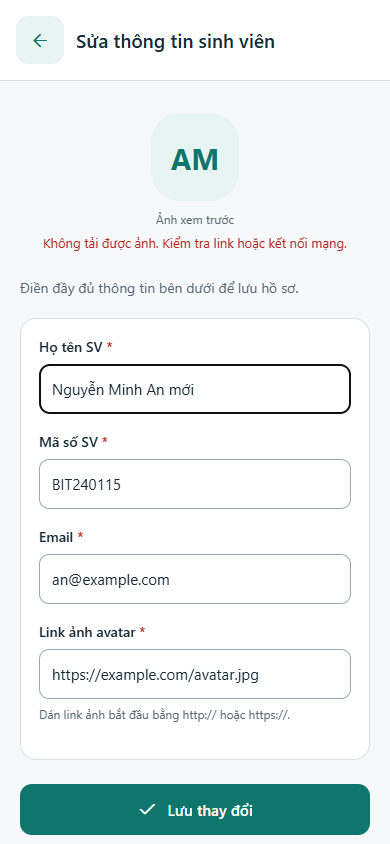
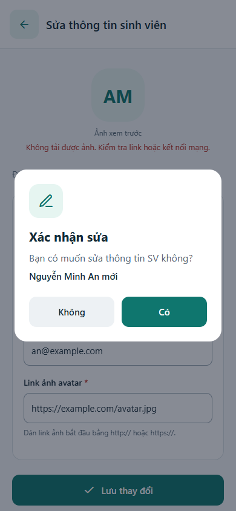
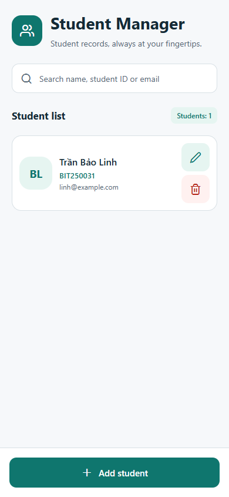

# BT Mobile Tuần 4 – Quản lý sinh viên

Ứng dụng React Native/Expo cho bài tập buổi 4: CRUD sinh viên, lưu dữ liệu local bằng AsyncStorage và tự đổi giao diện giữa tiếng Việt và tiếng Anh theo ngôn ngữ thiết bị.

## Đáp ứng yêu cầu

| Yêu cầu | Chức năng |
| --- | --- |
| Thông tin sinh viên | Họ tên, MSSV, email và avatar bằng link ảnh HTTP/HTTPS |
| Trang 1 | Danh sách sinh viên, tìm kiếm, nút thêm, sửa và xóa |
| Trang 2 | Xem chi tiết khi chạm vào sinh viên trong danh sách |
| Trang 3 | Form dùng chung cho thêm mới và sửa thông tin |
| CRUD | Thêm, xem, sửa, xóa; MSSV không được trùng |
| Local database | Đọc/ghi JSON bằng `@react-native-async-storage/async-storage` |
| Xác nhận sửa/xóa | Hộp thoại hỏi “Bạn có muốn sửa / xóa thông tin SV không?”; chỉ lưu khi chọn **Có** |
| Đa ngôn ngữ | Tên app, nút, nhãn, thông báo và lỗi bằng Việt/Anh, tự chọn theo thiết bị |

## Giao diện

Ảnh chụp bản web ở kích thước điện thoại. Hồ sơ minh họa dùng link ảnh không truy cập được để kiểm tra avatar dự phòng bằng chữ viết tắt.

| Danh sách | Chi tiết | Thêm / sửa |
| --- | --- | --- |
|  |  |  |

| Xác nhận sửa | Giao diện tiếng Anh |
| --- | --- |
|  |  |

## Chạy project

Cần Node.js 20 trở lên và npm.

```bash
npm ci
npm start
```

- Nhấn `w` để mở bản web local, hoặc chạy `npm run web`.
- Nhấn `a` để mở Android khi đã khởi động máy ảo và cài Android SDK.
- Dùng Expo Go tương thích với **Expo SDK 53** trên Android.
- Trên PowerShell, nếu `npm.ps1` bị chặn, dùng `npm.cmd ci` và `npm.cmd start`.

## Hướng dẫn demo

1. Nhấn **Thêm sinh viên**, nhập họ tên, MSSV, email và link ảnh avatar; nhấn **Lưu sinh viên**.
2. Quay về danh sách, chạm vào sinh viên để mở trang chi tiết.
3. Nhấn **Sửa thông tin**, thay đổi nội dung và nhấn **Lưu thay đổi**. Chọn **Không** để giữ dữ liệu cũ hoặc **Có** để cập nhật.
4. Nhấn **Xóa sinh viên**. Chọn **Không** để giữ hồ sơ hoặc **Có** để xóa.
5. Đóng rồi mở lại app, hoặc tải lại trang web, để kiểm tra dữ liệu vẫn được lưu.
6. Đổi ngôn ngữ hệ thống sang tiếng Việt/Anh rồi mở lại app. Trên Android, quay lại app từ Settings cũng cập nhật ngôn ngữ. Bản web theo ngôn ngữ trình duyệt.

Avatar dùng **link ảnh**, một trong hai phương án đề bài cho phép. Link lỗi hoặc mất mạng sẽ hiển thị chữ viết tắt của tên; link vẫn được lưu trong hồ sơ. Các trường đều bắt buộc, email phải đúng định dạng và MSSV phải duy nhất. Tên/MSSV do người dùng nhập được giữ nguyên, không dịch.

## Lưu trữ

Dữ liệu nằm ở key `@bt-mobile-tuan-4/students:v1` trong AsyncStorage. Mỗi bản ghi có `id`, `fullName`, `studentId`, `email`, `avatarUrl`. Không cần server.

Ứng dụng chờ ghi dữ liệu thành công rồi mới cập nhật giao diện. Khi ghi thất bại, hồ sơ cũ được giữ và có thông báo thử lại. Nếu dữ liệu đã lưu hỏng/không đọc được, app hiển thị lỗi và không tự ghi đè. Trên web, AsyncStorage sử dụng storage của trình duyệt; mỗi origin có dữ liệu riêng.

## Cấu trúc code

- [App.js](./App.js): chuyển giữa 3 màn hình, xử lý CRUD và hộp thoại xác nhận.
- [src/useStudents.js](./src/useStudents.js): tải dữ liệu và lưu thay đổi vào AsyncStorage.
- [src/studentModel.js](./src/studentModel.js): chuẩn hóa, kiểm tra thông tin, kiểm tra dữ liệu lưu và tìm kiếm.
- [src/i18n.js](./src/i18n.js): bản dịch Việt/Anh và chọn ngôn ngữ theo thiết bị.
- [src/screens](./src/screens): danh sách, chi tiết và form sinh viên.
- [src/components/UI.js](./src/components/UI.js): avatar, button, header và hộp thoại xác nhận.
- [plugins/withLocalizedAppName.js](./plugins/withLocalizedAppName.js): tên launcher Android Việt/Anh khi build app riêng. Tên launcher iOS dùng cấu hình `locales` trong `app.json`. Expo Go giữ tên launcher của Expo Go; tên bên trong app vẫn được dịch.

## Kiểm tra

```bash
npm test
npx expo export --platform all
```

Các test kiểm tra dữ liệu bắt buộc, MSSV trùng, email/link ảnh, dữ liệu local lỗi, tìm kiếm tiếng Việt và bản dịch.

Đã kiểm tra:

- 9 test dữ liệu và bản dịch đạt.
- CRUD trên trình duyệt: dữ liệu còn sau khi tải lại; chọn **Không** không sửa/xóa, chọn **Có** mới lưu.
- Lỗi ghi storage giữ hồ sơ cũ; dữ liệu JSON hỏng không bị tự ghi đè và có nút thử lại.
- Tự chọn Việt/Anh khi khởi động và đổi ngôn ngữ; bố cục điện thoại nhỏ, xoay ngang và tablet.
- Export bundle Android, iOS và web thành công. Chưa chạy kiểm tra trên thiết bị native cho bài này.

Tài liệu sử dụng: [AsyncStorage 2.x](https://react-native-async-storage.github.io/2.0/Usage/), [Expo Localization](https://docs.expo.dev/guides/localization/).
